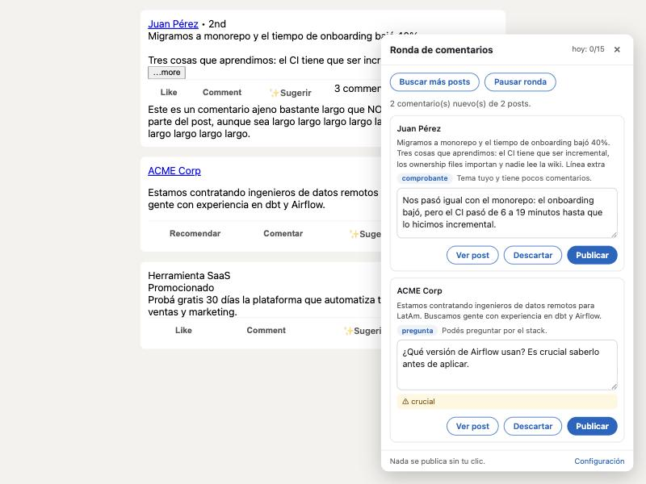

# LinkedIn Commenter

Extensión de Chrome que hace tu ronda de comentarios en LinkedIn con Claude, Gemini, DeepSeek u otra IA compatible con OpenAI.

Es parte de [linkedin-agent-skill-sp](https://github.com/guzzipa/linkedin-agent-skill-sp): las skills de LinkedIn en español para Claude. Las skills te ayudan con todo LinkedIn desde el chat (posts, perfil, plan semanal, DMs); esta extensión se ocupa solo de los comentarios, adentro de LinkedIn, y usa el mismo humanizador y las mismas reglas de `/li-comment`.

Mientras bajás por el feed, lee los posts, elige los que vale la pena comentar según los temas que te interesan y te deja un comentario escrito para cada uno. Vos los revisás y publicás cada uno con un clic.



- **Elige por vos.** Saltea publicidad, avisos sin contenido, temas delicados y posts donde no tenés nada concreto para sumar.
- **Escribe como una persona.** Usa 10 tipos de comentario (sumar un dato, el caso que falta, desacuerdo respetuoso, la pregunta de verdad…), nunca "¡Excelente post!", y solo usa datos tuyos que vos le diste.
- **Le saca la cara de IA.** Cada comentario pasa por un humanizador que elimina rayas largas, comillas curvas y caracteres invisibles, y marca con ⚠ las frases de manual ("crucial", "No es solo X, es Y") para que las cambies.
- **Aprende de vos.** Cuando editás un comentario antes de publicarlo o descartás una sugerencia, toma nota. Con el tiempo los borradores salen más parecidos a como escribís.
- **Nada se publica sin tu clic.** Ver más abajo por qué.

Funciona en español y en inglés: comenta en el idioma de cada post.

## Antes de empezar

Necesitás:

1. **Google Chrome** (o Brave, Edge, Arc u otro navegador basado en Chromium).
2. **Una API key de alguna de estas dos IA:**

| | Claude (Anthropic) | Gemini (Google) | DeepSeek | OpenRouter |
| --- | --- | --- | --- | --- |
| Dónde se saca | [console.anthropic.com](https://console.anthropic.com) → **API Keys** | [aistudio.google.com/apikey](https://aistudio.google.com/apikey) | [platform.deepseek.com](https://platform.deepseek.com/api_keys) | [openrouter.ai/keys](https://openrouter.ai/keys) |
| Costo | Por uso: entre 5 y 10 centavos de dólar por ronda con Opus 5.5, la mitad con Sonnet 5.5 | **Nivel gratuito**, con límites por minuto y por día | Por uso y muy barato: unas 20 veces menos que Claude | **Modelos `:free` gratis**, con límites por día |
| Calidad de los comentarios | La mejor | Buena | Buena | Depende del modelo que elijas |
| Privacidad | Anthropic no usa lo que mandás por la API para entrenar | **En el nivel gratuito, Google lo usa para mejorar sus productos** | **Procesa los datos en China** | Depende del proveedor de cada modelo |

La API de Anthropic va aparte de la suscripción a Claude.ai: tener Pro o Max no alcanza.

DeepSeek y OpenRouter están en la opción **DeepSeek, OpenRouter u otra compatible con OpenAI**. Esa misma opción sirve para cualquier API con el formato de OpenAI (Groq, Mistral, un modelo local): pegás la URL base y el modelo. **Ojo con los modelos más chicos o gratis:** respetan menos la regla de no inventar experiencias tuyas. Leé cada comentario antes de publicarlo.

## Instalación

### Opción A: descargar el zip (sin programar)

1. Entrá a [Releases](https://github.com/guzzipa/linkedin-agent-skill-sp/releases) y bajá el último `linkedin-commenter-vX.Y.Z.zip`. Está en los releases que se llaman **Extensión de Chrome**; los otros son de las skills.
2. Descomprimilo en una carpeta que no vayas a borrar (por ejemplo, `Documentos/linkedin-commenter`).
3. En Chrome, abrí `chrome://extensions` y activá **Modo de desarrollador** (arriba a la derecha).
4. Tocá **Cargar descomprimida** y elegí la carpeta del paso 2.
5. Fijá la extensión en la barra: ícono de rompecabezas 🧩 → 📌 al lado de **LinkedIn Commenter**.

### Opción B: desde el código

Necesitás [Node.js](https://nodejs.org) 22 o más nuevo.

```bash
git clone https://github.com/guzzipa/linkedin-agent-skill-sp.git
cd linkedin-agent-skill-sp/extension
npm install
npm run build
```

Después seguí los pasos 3 a 5 de la opción A, eligiendo la carpeta `dist/`.

## Configuración (5 minutos)

Tocá el ícono de la extensión para abrir la configuración. Lo que completes acá es lo único que el modelo sabe de vos, así que vale la pena dedicarle un rato.

| Campo | Qué poner |
| --- | --- |
| **Modelo de IA** | Claude o Gemini. |
| **API key** | La key del proveedor que elegiste. Después tocá **Probar conexión**. |
| **Quién sos** | Tu rol, años de experiencia, en qué trabajaste, opiniones fuertes. Ejemplo: *"Diseñadora de producto, 6 años en fintech en Bogotá. Lideré el rediseño de una app de pagos. Creo que la mayoría de los onboardings piden datos demasiado pronto."* Los comentarios solo usan lo que diga acá: si no está, no lo inventa. |
| **Tono** | Cómo hablás. Si escribís con vos o con usted, decilo acá. |
| **Comentarios tuyos de ejemplo** | 3 a 5 comentarios que hayas escrito vos. Es lo que más ayuda a que suene a vos. |
| **Temas en los que querés que te vean** | Uno por línea. Con esto decide qué posts comentar. Si lo dejás vacío, usa "Quién sos". |
| **Lo que aprendió de vos** | Las reglas que fue sacando de tus correcciones. Las podés editar o borrar. Ver [Aprende de tus correcciones](#aprende-de-tus-correcciones). |
| **Sugerencias por ronda** | Cuántos comentarios como máximo te propone por cada tanda de posts (5 por defecto). |
| **Máximo por día** | Cuando llegás, la ronda se frena hasta el día siguiente (15 por defecto). |
| **Saltear posts con más de N comentarios** | En un post con 200 comentarios el tuyo no lo ve nadie (40 por defecto). |

Tocá **Guardar** y recargá LinkedIn.

## Uso

1. **Entrá a LinkedIn y bajá por el feed** como siempre. Abajo a la derecha aparece el botón **💬 Ronda**.
2. **Esperá unos segundos.** Cuando juntó varios posts nuevos, la extensión los manda a Claude. Si alguno vale la pena, el botón pasa a decir **💬 3 para comentar** y el número aparece también en el ícono.
3. **Abrí el panel.** Cada tarjeta muestra:
   - de quién es el post y el principio del texto;
   - qué tipo de comentario eligió y por qué;
   - el comentario, que podés editar;
   - avisos ⚠ si quedó alguna frase con olor a IA.
4. **Elegí qué hacer con cada uno:**
   - **Publicar**: lo pega en la caja de comentario del post y lo publica.
   - **Descartar**: lo saca de la cola.
   - **Ver post**: te lleva al post para leerlo entero.

**Más opciones:**
- **Buscar más posts**: baja unas pantallas para que LinkedIn cargue más y vuelve adonde estabas.
- **Pausar ronda**: deja de leer el feed hasta que la reanudes.
- **✨ Sugerir**: está en cada post y te da 3 borradores distintos para ese post en particular.

### Aprende de tus correcciones

Usá la extensión como siempre: si un comentario no te convence, editalo antes de tocar **Publicar**, o descartalo. Cada vez guarda:

- **si lo editaste**, el borrador y tu versión final;
- **si lo publicaste sin cambios**, el comentario, como muestra de tu voz;
- **si lo descartaste**, el post y el motivo por el que te lo había propuesto.

Con eso:

1. En cada ronda le pasa a la IA tus últimas 6 correcciones, tus últimos 5 comentarios publicados y tus últimos 6 descartes.
2. Cada 8 correcciones o descartes nuevos, resume lo que cambiás siempre en reglas, por ejemplo "Escribí 1 o 2 oraciones como máximo" o "No propongas avisos de empleo".
3. Las reglas aparecen en la configuración, en **Lo que aprendió de vos**. Son texto común: corregilas, agregá las tuyas o tocá **Borrar lo aprendido** para empezar de cero. **Aprender ahora** las resume sin esperar a juntar 8.

### Qué saltea la ronda

- Posts patrocinados.
- Posts con muy poco texto.
- Posts con más comentarios que tu límite.
- Gente que ya comentaste en los últimos 7 días. Comentar siempre a las mismas personas se nota, y LinkedIn penaliza los grupos que se comentan entre sí.
- Lo que Claude descarta: publicidad, avisos de empleo sin contenido, duelos y temas personales delicados, política, y posts donde no tenés nada concreto para sumar.

Las sugerencias que no publicás vencen a las 36 horas, porque para entonces el post ya envejeció.

## Por qué no publica sola

[El Acuerdo de Usuario de LinkedIn](https://www.linkedin.com/legal/user-agreement) prohíbe comentar con bots, y LinkedIn restringe o suspende las cuentas que lo hacen. Por eso:

- **Cada comentario sale solo cuando tocás Publicar.** Ese clic tuyo es el control: nada se publica en segundo plano.
- **No recorre el feed sola.** Lee los posts que vos cargás al navegar, y solo baja la página cuando tocás **Buscar más posts**.
- **No intenta esconderse de LinkedIn.** No simula movimientos de mouse ni demoras al azar.

Leé cada comentario antes de publicarlo. Sale con tu nombre, y un comentario que entendió mal el post se nota.

## Privacidad

- **Tu API key** queda guardada solo en tu navegador (`chrome.storage.local`). Viaja directo a `api.anthropic.com` o a `generativelanguage.googleapis.com`, según el proveedor que elegiste. No pasa por ningún otro servidor.
- **Lo que se manda a la IA** para escribir los comentarios: el texto y el autor de los posts de tu feed, cuántos comentarios tienen, y lo que pusiste en la configuración. Ver la [política de privacidad de Anthropic](https://www.anthropic.com/legal/privacy) y los [términos de la API de Gemini](https://ai.google.dev/gemini-api/terms).
- **Con Gemini en el nivel gratuito**, Google puede usar ese contenido (que incluye posts de otras personas) para mejorar sus productos. Si eso te molesta, usá Claude o el nivel pago de Gemini.
- **Lo que queda en tu navegador:**
  - la cola de sugerencias;
  - un registro de a quién comentaste y cuándo, para no repetir autores;
  - tus últimas 200 correcciones y descartes, para aprender de vos. Algunas se mandan a la IA junto con cada ronda.

## Problemas frecuentes

| Qué pasa | Qué hacer |
| --- | --- |
| No aparece el botón 💬 | Recargá LinkedIn. Fijate en `chrome://extensions` que la extensión esté activada y sin errores. |
| "Falta la API key" | Abrí la configuración, pegá la key y tocá **Guardar**. |
| "API key inválida" o error 401 | La key está mal copiada o la borraste en la consola del proveedor. |
| "Tu cuenta de la API de Anthropic no tiene saldo" | Cargá saldo en [console.anthropic.com](https://console.anthropic.com) → **Billing**. La ronda se reintenta sola cada dos minutos. |
| "Llegaste al límite de uso de Gemini" | El nivel gratuito tiene límites por minuto y por día. Esperá, bajá **Sugerencias por ronda** o pasá al nivel pago. |
| Pasa un rato y no sugiere nada | Revisá que la ronda no esté en pausa y que **Temas** no sea demasiado estrecho. El panel dice cuántos posts leyó y cuántos descartó. |
| "Quedó en la caja de comentario: tocá Publicar en LinkedIn" | No encontró el botón de publicar: el comentario ya está pegado, tocá vos el botón de LinkedIn. Pasa cuando LinkedIn cambia su página. |
| "El post ya no está en esta página" | Te copia el comentario y abre el post en otra pestaña: pegalo ahí. |

LinkedIn cambia el HTML de su sitio seguido. Si algo deja de andar, [abrí un issue](https://github.com/guzzipa/linkedin-agent-skill-sp/issues) contando qué pasó.

## Para desarrolladores

| Archivo | Qué hace |
| --- | --- |
| `src/content.js` | Corre dentro de LinkedIn. Detecta los posts (por el botón "Comentar" y la barra de reacciones), lee autor y texto, arma las rondas, muestra los paneles (shadow DOM) y publica. |
| `src/background.js` | Service worker. Llama a la IA elegida con salida JSON estructurada, humaniza cada comentario y actualiza el contador del ícono. |
| `src/gemini.js` | Cliente de la API de Gemini (Interactions API con `response_format`), sin dependencias. |
| `src/openai-compat.js` | Cliente para APIs compatibles con OpenAI (`/chat/completions` con `json_object`, y el esquema en el prompt). Presets de DeepSeek y OpenRouter. |
| `src/prompt.js` | Prompts de **Sugerir** y de la ronda, esquemas de salida y valores por defecto de la configuración. |
| `src/humanize.js` | Port a JS de [`skills/li-human/humanize.py`](../skills/li-human/humanize.py). Lee los léxicos de [`skills/li-human/lexicons/`](../skills/li-human/lexicons) (hay una sola copia para las skills y la extensión) y traduce sus regex de Python a JS. |
| `src/options.*` | Página de configuración. |

**Modelo y API:**
- **Claude:** `claude-opus-5-5` por defecto, o `claude-sonnet-5-5`, con el SDK oficial. Usa `effort: "medium"` y `fallbacks: "default"`: si los clasificadores de seguridad rechazan un pedido, la API lo reintenta en otro modelo.
- **Gemini:** `gemini-3.8-flash` por defecto, o `gemini-3.5-flash-lite`, con `fetch` directo a la [Interactions API](https://ai.google.dev/gemini-api/docs/interactions) y `store: false`, para que Google no guarde la conversación. No usa `generateContent` porque devuelve 404 con las keys nuevas de AI Studio (las que empiezan con `AQ.`). Una ronda con 3.8 Flash tarda cerca de un minuto, porque el modelo piensa antes de responder.

```bash
npm run watch   # recompila al guardar; después ↻ en chrome://extensions y recargá LinkedIn
npm test        # humanizador (compara el JS contra el de Python, necesita python3) y cliente de Gemini
```

Si cambiás el léxico en `skills/li-human/lexicons/`, corré `npm run build` para que la extensión lo tome.

**Probar sin entrar a LinkedIn:** `test/mock-feed.html` imita el feed y simula la API y `chrome.storage`. Tiene cuatro posts:
- uno con las clases del feed viejo de LinkedIn;
- uno sin clases;
- uno patrocinado;
- uno armado como el feed nuevo (2026): sin clases legibles, cada post es un `role="listitem"`, el número de comentarios va adentro del botón y el botón de publicar aparece al escribir.

```bash
npm run build
python3 -m http.server 8765
```

Abrí `http://localhost:8765/test/mock-feed.html`: a los 8 segundos aparecen tres sugerencias.

**Si LinkedIn cambia su HTML.** Desde 2026 el feed casi no tiene clases legibles. Lo que la extensión usa hoy para orientarse:

| Qué | Cómo lo encuentra |
| --- | --- |
| El post | `[role="listitem"]` |
| Su ID | `componentkey="update-card-…"` |
| El texto | `[data-testid="expandable-text-box"]` |
| El autor | el `aria-label` del menú del post ("…post by {autor}") |
| La cantidad de comentarios | el número adentro del botón **Comment** |
| La caja de comentario | `[contenteditable][role="textbox"]`, que se monta recién cuando está en pantalla |

Dónde mirar si algo se rompe:
- **No aparece ✨ Sugerir:** revisá `COMMENT_RE`, `REACT_RE` y `findActionBar`, que buscan los botones por su `aria-label`.
- **Lee mal el post:** revisá `extractPost`. En **Sugerir**, el texto leído se puede corregir a mano.
- **No encuentra la caja o el botón de publicar:** revisá `findEditor` y `findSubmit`.

**Publicar una versión:**
1. Subí `version` en `package.json` y en `src/manifest.json`.
2. Pusheá un tag `extension-vX.Y.Z`. El workflow [`release-extension.yml`](../.github/workflows/release-extension.yml) arma el zip y crea el release. (Los tags `vX.Y.Z-es` son de las skills.)

## Créditos

- Los tipos de comentario y el humanizador vienen de las skills de este repo, que adaptan al español [linkedin-agent-skill](https://github.com/Jakeschincariol/linkedin-agent-skill) de Jake Schincariol.

## Licencia

MIT. Ver [LICENSE](LICENSE).
